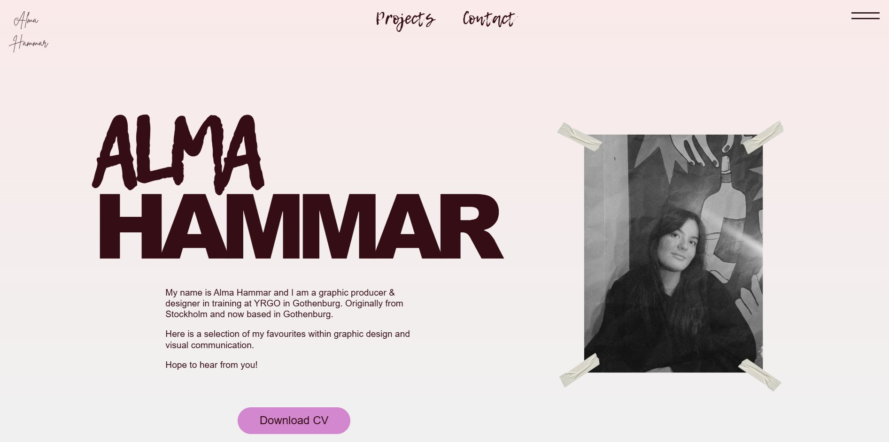

# Alma Hammar — Portfolio

A custom Next.js portfolio site for graphic design student Alma Hammar, built with Sanity as headless CMS and deployed on Vercel.

**Live site:** [hammargraphics.vercel.app](https://hammargraphics.vercel.app)



---

## Tech Stack

- **Frontend:** Next.js 15 (App Router)
- **CMS:** Sanity v5 (embedded Studio at `/studio`)
- **Styling:** Vanilla CSS with custom properties
- **Hosting:** Vercel
- **Fonts:** Self-hosted (.woff2) — Lemon Tuesday, Brittany Signature, TAN Meringue

---

## Project Structure

```
portfolio-alma/
├── public/
│   ├── assets/
│   │   ├── icons/        # SVG icons
│   │   ├── images/       # Static images (hero photo etc.)
│   │   └── motion/       # Video files (.mp4)
│   └── fonts/            # Self-hosted web fonts (.woff2)
│       ├── BrittanySignatureRegular.woff2
│       ├── LemonTuesday.woff2
│       └── TAN MERINGUE.woff2
├── src/
│   ├── app/
│   │   ├── page.js               # Home page (hero + project cards)
│   │   ├── layout.js             # Root layout — imports CSS, Header, Footer
│   │   ├── globals.css           # CSS variables, @font-face, resets
│   │   ├── projects/
│   │   │   └── [slug]/
│   │   │       └── page.js       # Dynamic project page
│   │   └── studio/
│   │       └── [[...tool]]/
│   │           └── page.jsx      # Embedded Sanity Studio
│   ├── components/
│   │   ├── BackToTop.js          # Back to top button (client component)
│   │   ├── ClientScripts.js      # Global client-side scripts
│   │   ├── Contact.js            # Contact section
│   │   ├── Footer.js             # Footer with social links
│   │   ├── Header.js             # Site header (server component)
│   │   ├── Lightbox.js           # Image/video lightbox via React Portal
│   │   └── Nav.js                # Navigation with overlay (client component)
│   ├── sanity/
│   │   ├── env.js                # Sanity project ID and dataset
│   │   ├── lib/
│   │   │   ├── client.js         # Sanity client
│   │   │   ├── image.js          # Image URL builder
│   │   │   ├── live.js           # Live preview
│   │   │   └── queries.js        # GROQ queries
│   │   ├── schemaTypes/
│   │   │   ├── index.js          # Schema registry
│   │   │   ├── project.js        # Project document schema
│   │   │   └── siteSettings.js   # Site settings singleton schema
│   │   └── structure.js          # Studio structure
│   └── styles/
│       ├── contact.css
│       ├── footer.css
│       ├── hero.css
│       ├── project-cards.css
│       └── projects.css
├── sanity.config.js
├── next.config.mjs
└── .env.local                    # Sanity credentials (not in repo)
```

---

## Features

- **Fixed signature** — links back to start, stays visible on scroll with `mix-blend-mode: exclusion`
- **Navigation overlay** — hamburger opens a panel with nav links and contact info; on desktop the links are visible in the header
- **Conditional nav** — "Projects" link on the home page, "Start" on project pages
- **Image lightbox** — click any gallery image to open it fullscreen; close with button or backdrop click
- **Video lightbox** — motion design thumbnails open a video lightbox on click
- **Hover overlays** — project cards show title on hover
- **Back to top button** — appears after scrolling down, fixed bottom right
- **CV download** — linked from the hero section
- **PortableText hero** — hero text is managed via Sanity and rendered with `@portabletext/react`
- **Content managed entirely in Sanity** — all projects, gallery images, contact details and CV are added via Sanity Studio

---

## Getting Started

### Prerequisites

- Node.js 18+
- A Sanity account (free at [sanity.io](https://sanity.io))

### Installation

```bash
git clone https://github.com/Patricia-LF/portfolio-alma.git
cd portfolio-alma
npm install
```

### Environment variables

Create a `.env.local` file in the root:

```
NEXT_PUBLIC_SANITY_PROJECT_ID=your_project_id
NEXT_PUBLIC_SANITY_DATASET=production
```

Your project ID is found at [sanity.io/manage](https://sanity.io/manage).

### Run locally

```bash
npm run dev
```

- Site: `http://localhost:3000`
- Sanity Studio: `http://localhost:3000/studio`

If the dev server runs on a different port (e.g. http://localhost:3001),
add that origin to Sanity's allowed list:
sanity.io/manage → your project → API → CORS Origins → Add origin

---

## Content Management

All content is managed via Sanity Studio at `/studio`. See [SANITY-GUIDE.md](./SANITY-GUIDE.md) for a step-by-step guide aimed at Alma.

### Document types

- **Project** — title, slug, type (project/concept), description, cover image, card size, and a gallery of images/videos
- **Site settings** — hero text, CV file, phone, email, Instagram, LinkedIn

---

## Deployment

The site is hosted on Vercel and deploys automatically on push to `main`, and also when content is published in Sanity Studio via a webhook.

### Environment variables on Vercel

Go to your project on Vercel → **Settings** → **Environment Variables** and add: `NEXT_PUBLIC_SANITY_PROJECT_ID` and `NEXT_PUBLIC_SANITY_DATASET`.

Then trigger a redeploy for the variables to take effect.

### Domain setup (Strato → Vercel)

The domain hammargraphics.com is registered at Strato with the following DNS records pointing to Vercel:

- **A record:** `@` → `216.198.79.1`
- **CNAME:** `www` → `69bf89116708973d.vercel-dns-017.com`

Both `hammargraphics.com` and `www.hammargraphics.com` are added under **Settings → Domains** in the Vercel project.

### CORS — allow Sanity Studio on the live domain

1. Go to [sanity.io/manage](https://sanity.io/manage) → your project → **API** → **CORS Origins**
2. Add `https://www.hammargraphics.com` with **Allow credentials** enabled

### Sanity webhook — automatic redeploy on publish

To trigger a new Vercel deploy whenever content is published in Sanity Studio:

1. In Vercel: **Settings** → **Git** → **Deploy Hooks** → create a hook for branch `main` and copy the URL
2. In Sanity: [sanity.io/manage](https://sanity.io/manage) → **API** → **Webhooks** → create a webhook with:
   - **URL:** the Vercel deploy hook URL
   - **Dataset:** production
   - **Trigger on:** Create, Update, Delete

---

## License

Copyright © 2026 Alma Hammar. All Rights Reserved.

The design, images, and visual content in this repository are the intellectual property of Alma Hammar and may not be reproduced, distributed, or used without explicit written permission.

Theme code developed by [Patricia Loayza Frykberg](https://patriciafrykberg.se/portfolio).
